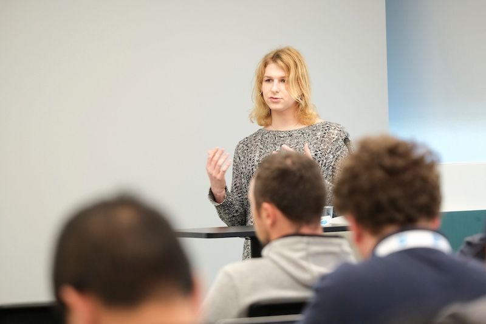

export const dimensions = {
    "max-width": "192px",
    "max-height": "96px",
    margin: "0 20px",
};

### 👋 Welcome! My name is Mya 👋

[![Name Pronunciation][]](https://www.google.com/search?q=pronunciation+maya)
[![Pronouns: she / her][]](https://pronoun.is/she)

[Name Pronunciation]:
    https://img.shields.io/badge/Pronunciation%20%F0%9F%94%88-mai·uh-pink?style=for-the-badge&labelColor=silver
[Pronouns: she / her]: https://img.shields.io/badge/Pronouns-she%2Fher-pink?style=for-the-badge&labelColor=silver

I'm a software engineer and engineering leader with over 20 years of experience building systems that scale. I
specialize in **platform engineering, AI infrastructure, and distributed systems** - helping organizations build
reliable, secure platforms from the ground up. Currently, I lead platform engineering at [Gigawatt AI][], managing teams
across product, AI, integrations, and core infrastructure. I'm occasionally available for [technical consulting][collab]
for individuals advancing their careers and companies optimizing their tech stack.

I've been programming since I was a kid. At 15, I started my first website development company. At 22, I co-founded a
startup building tools for job seekers. Since then, I've worked across diverse organizations (from startups to
enterprises) solving complex technical challenges and leading engineering teams.

I believe in **building in public** and giving back to the community. You'll find my work on [GitHub][], my thoughts in
[blog posts][blog], and my [Helm charts][charts] that others can use.

#### Beyond the keyboard

Outside of work, I'm an avid [hockey][] player and intermediate pianist (you can find my recordings in the [media
section][media]). I'm also a parent to both humans and pets.

Something you may notice is my site uses a hyperlegible font. I often struggle to interpret characters when reading on
screens, so I often favor screen readers for consuming content, including my own writing.

#### What I'm working on

Currently, I'm the Senior Engineering Manager for platform engineering at [Gigawatt AI][], leading four teams:

- _Product Platform_ develops complex features and functionality that spans all product teams at [Gigawatt AI][].
- _AI Platform_ turns a complex subsystem into a pluggable product that allows other teams to augment agents with their
  area of expertise.
- _Data & Core Infrastructure_ offers a diverse range of expertise spanning security, data engineering, and reliability
  engineering.
- _Integrations Platform_, while not yet formed, seemlessly enables our ecosystem to communicate with customers on-prem
  legacy infrastructure.

These days, I'm deeply into the intersection of **software, hardware, and 3D printing** - bringing together my technical
skills with hands-on fabrication. When I have time, I still tinker with [Raspberry Pi][] clusters.

[Gigawatt AI]: https://gigawatt.ai
[GitHub]: https://github.com/mjpitz
[Raspberry Pi]: https://raspberrypi.com
[hockey]: /hockey
[blog]: /blog
[charts]: /charts
[collab]: /collab
[media]: /media

---

**Want to work together?** [Book a free consultation →][collab]
